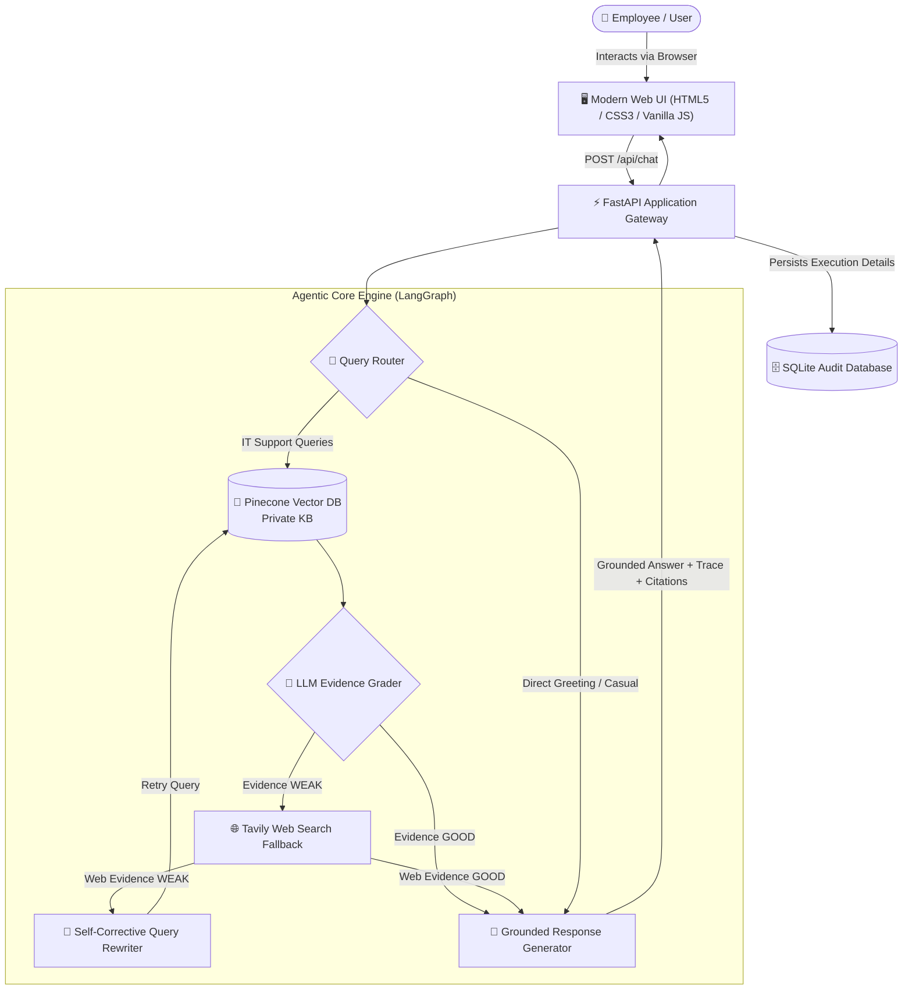
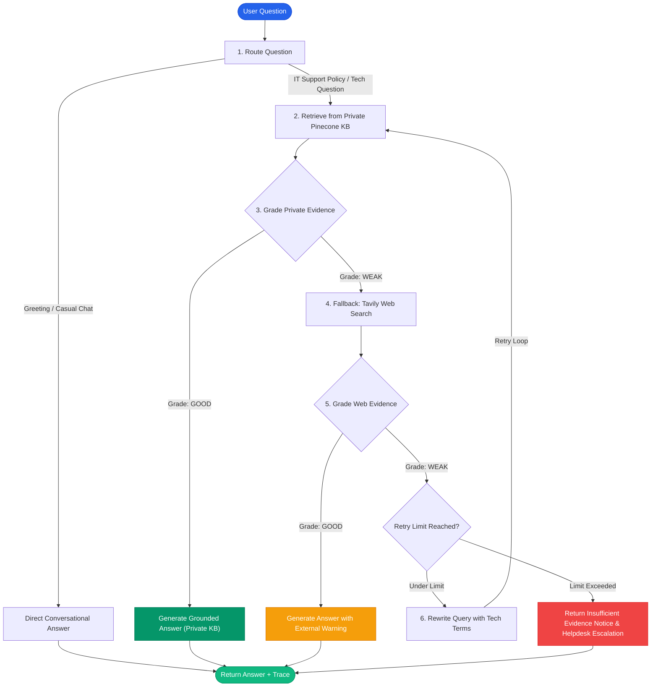

<div align="center">

# 🛡️ Enterprise IT Support Agentic RAG Copilot

**An End-to-End Forward Deployed Engineer (FDE) Solution for Autonomous Internal IT Operations**

[](https://python.org)
[](https://fastapi.tiangolo.com)
[](https://langchain-ai.github.io/langgraph/)
[](https://www.pinecone.io/)
[](https://openai.com)
[](https://groq.com)
[](https://www.docker.com)
[](LICENSE)

<br/>

[Key Features](#-key-features) •
[Architecture](#-system-architecture) •
[Agentic Workflow](#-agentic-rag-workflow) •
[Quickstart](#-quick-start) •
[Demo Scenarios](#-interactive-demo-scenarios) •
[API Reference](#-api-reference) •
[Production Hardening](#-production-hardening-roadmap)

<br/>

</div>

---

## 📌 Executive Summary & Business Problem

In mid-sized to enterprise organizations (e.g., **NovaRetail**, 3,000+ employees), IT Service Desks face high ticket volumes for routine questions: VPN setup, password resets, MFA enrollment, software provisioning, and hardware troubleshooting.

### The Problem with Traditional Approaches:
* 🔍 **Keyword Search Fails:** Confluence and SharePoint search return too many conflicting, outdated results.
* 🤖 **Naive Chatbots Hallucinate:** Out-of-the-box LLMs make up company policies, which can cause severe security risks (e.g., advising users to share MFA tokens).
* 🔒 **Information Silos vs. Fresh Vendor Data:** Internal wikis cannot know about live, ongoing Microsoft 365, Slack, or AWS outages without searching the public web, but public web bots cannot be trusted with proprietary internal configurations.

### The Solution:
The **Enterprise IT Support Agentic RAG Copilot** transforms static documentation into an autonomous, state-driven decision engine. It implements a strict **private-knowledge-first** routing strategy with **evidence self-grading**, **automated query rewriting**, and **guarded external web search fallbacks**, fully observable through real-time agent execution traces.

---

## ✨ Key Features

| Capability | Description |
| :--- | :--- |
| 🛡️ **Private Knowledge First** | Prioritizes corporate knowledge base stored in Pinecone before considering any external network access. |
| 🧠 **Self-Reflective Grading** | Evaluates retrieved document chunks with structured outputs (`good` vs `weak`) before generating responses. |
| 🌐 **Guarded Web Fallback** | Integrates Tavily Search API only when internal documentation is missing or insufficient for the query. |
| 🔄 **Self-Corrective Query Rewriter** | Automatically enhances vague or poorly phrased prompts with technical keywords and retries retrieval up to configurable limits. |
| ⚡ **Real-Time Execution Tracing** | Exposes the complete LangGraph decision trajectory (`Router → Private KB → Grader → Fallback → Answer`) in the UI. |
| 📂 **Dynamic Multi-Format Ingestion** | Secure endpoint (`POST /api/ingest`) for admins to ingest `.pdf`, `.docx`, `.txt`, and `.md` files without redeploying. |
| 📜 **Audit & Provenance Logging** | SQLite-backed audit trails documenting every query, citation, source type, and execution path for corporate compliance. |
| 🐳 **Cloud & Docker Ready** | Pre-configured container setup with lightweight multi-stage builds and centralized environment configuration. |

---

## 🏗️ System Architecture



---

## 🔄 Agentic RAG Workflow

Unlike standard naive RAG pipelines that execute a fixed `Query → Embed → Retrieve → Generate` chain, this system uses a stateful **LangGraph** workflow that autonomously assesses evidence confidence at each step:



### Why Agentic RAG Outperforms Traditional RAG:

> [!NOTE]
> * **Standard RAG:** Assumes top-k vector similarity always yields relevant context. If the document is missing, it forces the LLM to hallucinate from irrelevant chunks.
> * **Agentic RAG:** Validates the semantic relevance of context against the query. If the retrieved context is low quality, it proactively initiates an alternate plan (external search, query rewriting, or gracefully escalating to human IT support).

---

## 📂 Repository Structure

```text
Enterprise-IT-Support-Agentic-RAG-Copilot/
├── app/
│   ├── api/
│   │   ├── __init__.py
│   │   └── routes.py              # REST endpoints: /chat, /ingest, /health
│   ├── core/
│   │   ├── __init__.py
│   │   ├── config.py              # Centralized Pydantic BaseSettings
│   │   └── logging.py             # Enterprise logging configurations
│   ├── rag/
│   │   ├── __init__.py
│   │   ├── state.py               # LangGraph AgentState and Pydantic grading models
│   │   ├── vectorstore.py         # Pinecone client & OpenAI embeddings
│   │   └── workflow.py            # LangGraph state machine & decision nodes
│   ├── services/
│   │   ├── __init__.py
│   │   ├── audit.py               # SQLite audit log storage
│   │   └── ingestion.py           # Document loading (PDF, DOCX, TXT, MD) & chunking
│   └── main.py                    # FastAPI entrypoint & static mount
├── data/
│   ├── sample_kb/                 # Default knowledge base policies
│   │   ├── company_it_handbook.md # Corporate IT security and access guidelines
│   │   └── service_desk_runbook.md# Tier-1 troubleshooting procedures
│   └── audit.db                   # SQLite runtime audit database
├── docs/                          # Architecture diagrams & FDE problem statement
├── static/
│   ├── css/style.css              # Custom responsive stylesheet
│   └── js/app.js                  # Frontend client & dynamic trace renderer
├── templates/
│   └── index.html                 # Clean, responsive web dashboard
├── Agentic-RAG-demo/              # Exploratory Jupyter notebooks
├── uploads/                       # Temporary staging directory for ingested files
├── .dockerignore
├── .env.example                   # Environment configuration template
├── .gitignore
├── Dockerfile                     # Multi-stage container specification
├── create_project.py              # Scaffolding utility
├── ingest_sample_kb.py            # Bulk ingestion script for sample documents
├── requirements.txt               # Locked production dependencies
├── run.py                         # Local Uvicorn server launcher
└── steps.md                       # Implementation roadmap & guide
```

---

## 🚀 Quick Start

### 1. Prerequisites
* Python 3.10, 3.11, or 3.12
* [Pinecone API Key](https://www.pinecone.io/)
* [OpenAI API Key](https://platform.openai.com/)
* [Tavily API Key](https://tavily.com/)

### 2. Clone and Setup Environment

```bash
# Clone the repository
git clone https://github.com/MallaManoj/Enterprise-IT-Support-Agentic-RAG-Copilot.git
cd Enterprise-IT-Support-Agentic-RAG-Copilot

# Create and activate virtual environment
# On macOS / Linux:
python3 -m venv venv
source venv/bin/activate

# On Windows:
# python -m venv venv
# venv\Scripts\activate
```

### 3. Install Dependencies

```bash
pip install --upgrade pip
pip install -r requirements.txt
```

### 4. Configure Environment Variables

Copy `.env.example` to `.env` and fill in your API credentials:

```bash
cp .env.example .env
```

Edit `.env` with your preferred settings:

```ini
# External Search
TAVILY_API_KEY=tvly-xxxxxxxxxxxxxxxxxxxx

# Vector Database (Pinecone)
PINECONE_API_KEY=pcsk_xxxxxxxxxxxxxxxxxxxx
PINECONE_INDEX_NAME=fde-it-support-rag
PINECONE_NAMESPACE=company-it-kb

# LLM Models
OPENAI_API_KEY=sk-proj-xxxxxxxxxxxxxxxxxxxx
OPENAI_MODEL=gpt-4o-mini
EMBEDDING_MODEL=text-embedding-3-small

# Security
ADMIN_API_KEY=super-secret-admin-key-123

# Application Settings
APP_ENV=development
```

### 5. Ingest Sample Knowledge Base

Load the included IT handbook and troubleshooting runbooks into Pinecone:

```bash
python ingest_sample_kb.py
```

```text
Indexing: /.../data/sample_kb/company_it_handbook.md
-> Created 2 chunks
Indexing: /.../data/sample_kb/service_desk_runbook.md
-> Created 2 chunks
Sample KB ingested into Pinecone namespace 'company-it-kb'.
```

### 6. Launch the Application

```bash
python run.py
```

* **Web Copilot Dashboard:** [http://127.0.0.1:8000](http://127.0.0.1:8000)
* **Interactive Swagger API Docs:** [http://127.0.0.1:8000/docs](http://127.0.0.1:8000/docs)
* **ReDoc Documentation:** [http://127.0.0.1:8000/redoc](http://127.0.0.1:8000/redoc)

---

## 🧪 Interactive Demo Scenarios

Test the agent with these representative scenarios to observe how it routes and adapts:

### Scenario 1: Private Company Knowledge Match
* **User Query:** `"How do I connect to the company VPN from home?"`
* **Agent Trace:**
  ```text
  Router → KB
  Private KB retrieval → 4 chunks
  KB evidence grade → GOOD
  Answer generation → PRIVATE KB
  ```
* **Behavior:** Directly extracts official VPN setup procedures from `company_it_handbook.md`. No external web requests are made.

---

### Scenario 2: Strict Security & Compliance Policy
* **User Query:** `"Can an IT support technician ask for my MFA authentication code?"`
* **Agent Trace:**
  ```text
  Router → KB
  Private KB retrieval → 4 chunks
  KB evidence grade → GOOD
  Answer generation → PRIVATE KB
  ```
* **Behavior:** Accurately warns the user that IT staff will **never** request MFA codes or passwords, citing internal policy verbatim.

---

### Scenario 3: Missing Internal Info with Live Web Fallback
* **User Query:** `"What is the latest status and outage guidance for Microsoft Teams?"`
* **Agent Trace:**
  ```text
  Router → KB
  Private KB retrieval → 4 chunks
  KB evidence grade → WEAK
  Web fallback → Tavily search
  Web evidence grade → GOOD
  Answer generation → WEB SEARCH
  ```
* **Behavior:** Recognizes private KB does not contain real-time service health; fetches live status via Tavily and includes an explicit external-data advisory.

---

### Scenario 4: Self-Corrective Query Rewriting
* **User Query:** `"My company comms software is throwing a strange error after the update."`
* **Agent Trace:**
  ```text
  Router → KB
  Private KB retrieval → 4 chunks
  KB evidence grade → WEAK
  Web fallback → Tavily search
  Web evidence grade → WEAK
  Query rewrite → "enterprise communication software update error troubleshooting"
  Private KB retrieval → 4 chunks
  ...
  ```
* **Behavior:** Automatic query expansion when initial search yields poor relevance, bounded by `max_retries` guardrails.

---

### Scenario 5: Direct Conversational Filtering
* **User Query:** `"Good morning, hope you're having a great day!"`
* **Agent Trace:**
  ```text
  Router → DIRECT
  Direct response → no retrieval
  ```
* **Behavior:** Bypasses vector database searches and tool calls to reduce latency and token costs.

---

## 📡 API Reference

### Health Check
`GET /api/health`

```bash
curl -X GET http://127.0.0.1:8000/api/health
```

**Response (`200 OK`):**
```json
{
  "status": "ok",
  "service": "Enterprise IT Support Agentic RAG Copilot"
}
```

---

### Chat Endpoint
`POST /api/chat`

```bash
curl -X POST http://127.0.0.1:8000/api/chat \
  -H "Content-Type: application/json" \
  -d '{"question": "How do I reset my company password?"}'
```

**Response (`200 OK`):**
```json
{
  "answer": "To reset your password, visit the self-service portal at identity.company.com. You will need to verify your identity via the registered MFA authenticator app. Passwords must be at least 14 characters long and cannot reuse the last 5 passwords.",
  "source_used": "private_kb",
  "trace": [
    "Router → KB",
    "Private KB retrieval → 4 chunks",
    "KB evidence grade → GOOD",
    "Answer generation → PRIVATE KB"
  ],
  "citations": [
    {
      "title": "company_it_handbook.md",
      "url": "",
      "type": "private_kb"
    }
  ],
  "rewritten_query": "How do I reset my company password?"
}
```

---

### Document Ingestion Endpoint (Admin Protected)
`POST /api/ingest`

Upload and index new corporate documents dynamically into Pinecone.

```bash
curl -X POST http://127.0.0.1:8000/api/ingest \
  -H "X-Admin-Key: super-secret-admin-key-123" \
  -F "file=@/path/to/remote_work_security_policy.pdf"
```

**Response (`200 OK`):**
```json
{
  "message": "Document indexed",
  "file": "remote_work_security_policy.pdf",
  "chunks": 6,
  "ids_created": 6
}
```

---

## 🐳 Docker Deployment

Run the complete application in an isolated container:

```bash
# Build the Docker image
docker build -t enterprise-it-agentic-rag .

# Run the container with environment variables
docker run -d \
  -p 8000:8000 \
  --env-file .env \
  --name it-support-copilot \
  enterprise-it-agentic-rag
```

Inspect container status:
```bash
docker ps
docker logs -f it-support-copilot
```

---

## 🛡️ Production Hardening Roadmap

For enterprise-grade rollout, the following production enhancements can be integrated:

- [ ] **Enterprise Identity (SSO / OIDC):** Integrate Okta, Azure AD, or Google Workspace for role-based access control (RBAC).
- [ ] **Document Metadata Security Filtering:** Enforce tenant/department authorization tags directly within Pinecone index queries.
- [ ] **Observability & Evaluation:** Integrate LangSmith / Arize Phoenix to track latency, hallucination rates, and answer correctness.
- [ ] **PII & Data Redaction:** Automatically scrub employee SSNs, credit card numbers, and API secrets from prompts before processing.
- [ ] **Distributed Queue Ingestion:** Celery / Redis queue workers for asynchronous indexing of high-volume PDF and archive libraries.

---

## 🤝 Contributing

Contributions, bug reports, and suggestions are welcome!

1. Fork the Project
2. Create your Feature Branch (`git checkout -b feature/AmazingFeature`)
3. Commit your Changes (`git commit -m 'Add some AmazingFeature'`)
4. Push to the Branch (`git push origin feature/AmazingFeature`)
5. Open a Pull Request

---

## 📄 License

Distributed under the Apache-2.0 License. See [`LICENSE`](LICENSE) for more details.

---

<div align="center">

Developed with ❤️ by **[Malla Manoj](https://github.com/MallaManoj)**

</div>
